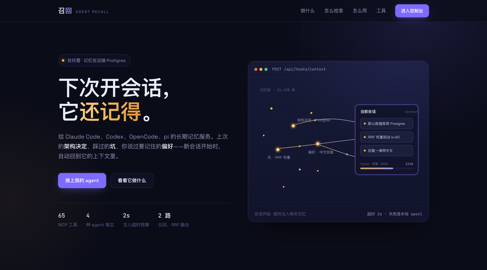
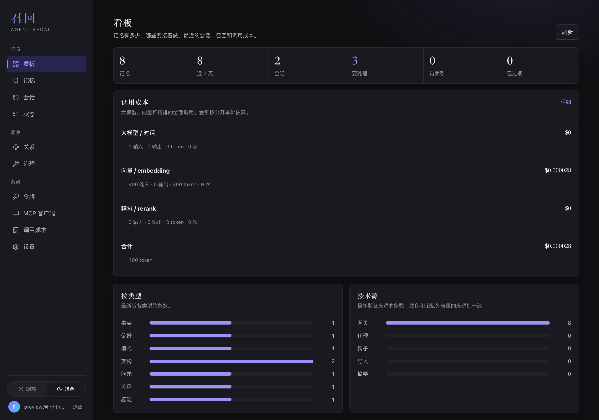
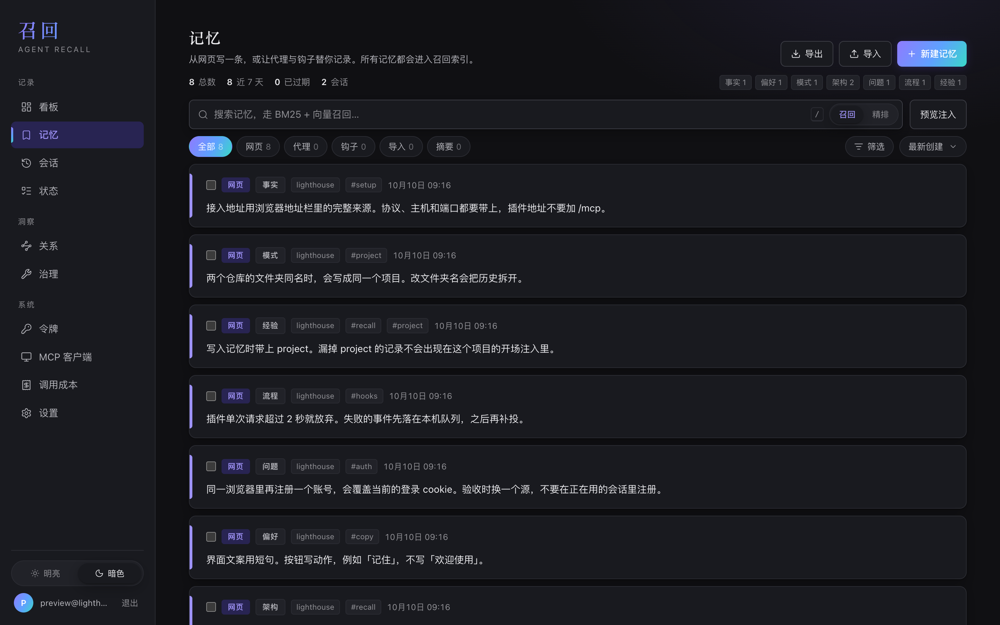
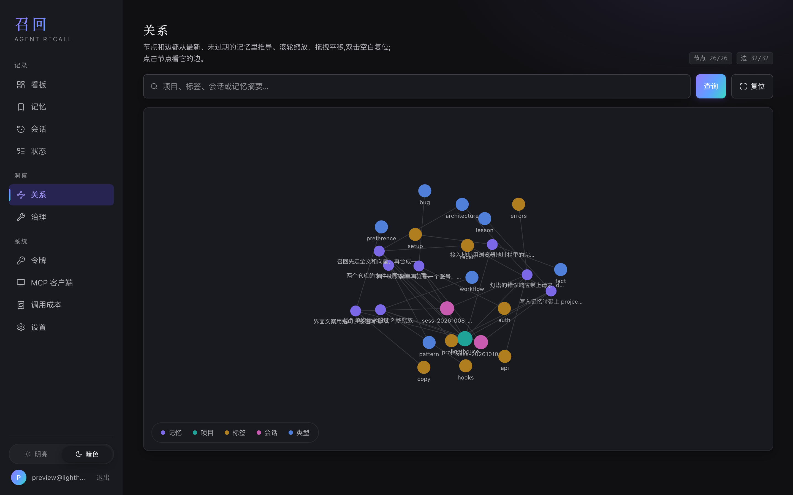

# agent-recall

agent-recall 是一个自托管的 agent 记忆服务，让不同的 agent 和设备可以共用记忆，不必在每次新会话里重复交代项目背景。

- **跨 agent 使用**：支持 Claude Code、Codex CLI、OpenCode、pi 等兼容 MCP 的 coding agent。架构决定、遇到的问题和个人偏好可以在不同 agent 之间复用。
- **多设备访问**：记忆保存在服务端，各台设备连接同一个服务即可使用。
- **按需召回**：结合全文检索和向量检索，筛选相关记忆作为上下文，减少提示词的 token 占用。
- **自托管**：数据保存在自己的 Postgres 中，全文检索和向量检索服务可按需配置。

## 预览

以下依次是公开首页，以及登录后的看板、记忆列表和关系图。截图使用 `lighthouse` 项目的示例数据。









## 主要功能

可以通过插件、MCP 工具和网页使用 agent-recall：

- **插件自动记录和注入上下文**：在会话开始和每次提问前检索相关记忆，工具调用后记录观察，会话结束后生成摘要。单次请求超时为 2 秒，发送失败的事件保存在本地，后续可重新发送。
- **Agent 通过 MCP 读写记忆**：支持保存、检索、更新、删除和整理记忆。远程 HTTPS 接入无需安装包，提供 62 个服务端工具；本地 stdio 接入另外提供 3 个本地文件工具。
- **在网页中查看和管理**：看板展示记忆统计、待办行动和最近的会话及召回记录。还可以筛选和检索记忆、使用精排、分享记忆、查看历史版本、浏览会话时间线与结晶，以及管理状态、关系和治理。接入令牌和 MCP 客户端配置在网页中创建。

文件压缩、本地 `MEMORY.md` 同步和 Obsidian 导出由本地工具完成。

更新记忆时会保留历史版本，检索只使用最新版本。相同内容在五分钟内不会重复保存。入库前会过滤 API key、Bearer token、PEM 和 `<private>` 标签内的内容。

新会话的上下文使用来自网页、agent、会话摘要和导入的记忆。插件记录的原始观察会保存在库中供后续查看，不会自动注入提示词。

检索使用 Meilisearch 做全文匹配、Qdrant 做语义匹配，然后合并排序。可以在设置中启用精排；未启用或精排失败时，使用合并后的排序。只配置其中一项也可以检索；两项都未配置时，仍可按条件筛选记忆列表。

## 接入 agent

接入前需要一个已部署的 agent-recall 服务。下文以 `https://你的站点` 为例；使用时请替换为实际服务地址，包含协议、主机和端口（如有）。

1. 打开 agent-recall 网页，注册并登录。
2. 在「MCP 客户端」页面注册客户端，获取接入配置。令牌仅显示一次，请妥善保存。也可以在「令牌」页面单独创建以 `arm_` 开头的令牌。
3. 将配置添加到 agent 中。控制台提供以下两种配置，使用相同的令牌，按需选择即可。

**远程 HTTPS**：无需安装包，不包含本地文件工具。若只需要部分工具，可在 URL 后添加 `?profile=core` 或 `?profile=standard`：

```json
{
  "mcpServers": {
    "agent-recall": {
      "type": "http",
      "url": "https://你的站点/mcp",
      "headers": {
        "Authorization": "Bearer arm_..."
      }
    }
  }
}
```

**本地 stdio**：需要 Node.js 22，通过 `npx` 下载已发布的包。`full` 配置包含 3 个本地文件工具：

```json
{
  "mcpServers": {
    "agent-recall": {
      "command": "npx",
      "args": ["-y", "@yeanzhi/agent-recall-mcp"],
      "env": {
        "AGENT_RECALL_URL": "https://你的站点",
        "AGENT_RECALL_TOKEN": "arm_..."
      }
    }
  }
}
```

控制台根据服务器的 `PUBLIC_BASE_URL` 生成地址。若与实际访问地址不一致，请改为实际服务地址。插件的 `AGENT_RECALL_URL` 使用服务的根地址，不包含 `/mcp` 路径。

配置完成后，可以对 agent 说「记住我们用请求 id 追踪接口错误」，让它保存一条记忆，再尝试检索。

如需自动记录会话并在新会话中注入相关记忆，请继续[安装插件](#安装插件)。插件使用同一组服务地址和令牌。

仅配置 MCP 时，agent 可以调用记忆工具，但不会自动注入上下文。远程接入提供 62 个服务端工具，本地 stdio 的 `full` 配置提供 65 个工具。

## 一次会话里发生什么

假设你在上一次会话中保存了两条决定：接口错误需要包含请求 id，列表默认按更新时间排序。

安装插件后，新会话开始时会加载相关记忆。当你问「错误响应里有没有请求 id」时，插件还会根据问题检索记忆，将相关内容补充到上下文中，省去重复交代的过程。

当你要求记住新的决定时，agent 会调用 `memory_remember` 保存。插件负责记录工具调用后的观察，服务器在会话结束后生成摘要。

## 网页功能

| 路径 | 登录 | 用来做什么 |
|---|---|---|
| `/` | 不用 | 说明：项目做什么、怎么接、65 个工具。可按名字或用途筛选 |
| `/login` | 不用 | 注册 / 登录 |
| `/board` | 要 | 看板：记忆统计、调用成本、待办行动、最近会话、召回记录和记忆库状态 |
| `/memories` | 要 | 筛选、召回、精排、注入预览、分享、版本、导入导出 |
| `/sessions` | 要 | 会话列表、时间线、结晶 |
| `/state` | 要 | 行动、信号、哨兵、槽位、档案、租约、例程、检查点 |
| `/graph` | 要 | 由记忆推导出的关系 |
| `/ops` | 要 | 诊断与修复、合并、反思、快照、收到的分享、审计 |
| `/tokens` | 要 | 创建和管理令牌，明文仅在创建时显示 |
| `/mcp` | 要 | 注册 MCP 客户端，签发远程 HTTPS 和本机 stdio 两份配置 |
| `/cost` | 要 | 大模型、向量、精排的 token 消耗、估算费用和调用记录 |
| `/settings` | 要 | 大模型、精排、自动遗忘、召回历史 |

未登录时访问控制台会跳转到登录页，也可以从登录页返回项目首页。

## 常用工具

| 工具 | 什么时候用 |
|---|---|
| `memory_remember` | 你明确说记住一件事 |
| `memory_recall` | 有一个具体问题 |
| `memory_smart_search` | 问题较宽泛，需要更深入地搜索 |
| `memory_context` | 要一段能直接放进提示词的上下文 |
| `memory_update` | 改正一条已有记忆，旧版保留 |
| `memory_forget` | 删掉整条版本链 |
| `memory_next` | 会话刚开始，先看未完成的行动和最近的记忆 |

完整工具列表按写入、召回、浏览、会话记录、状态、关系、共享和整理分为八组，见 [工具文档](docs/tools.md)。网页首页也支持按名称和用途筛选工具。各工具的参数说明通过 MCP 提供给 agent。

## 安装插件

安装时请保留完整的 `plugins/` 目录，Claude Code 和 Codex 插件依赖其中的共享客户端。这两个插件均附带 `agent-recall-init` 技能：在目标仓库中说「初始化仓库」或运行 `/agent-recall-init`，即可将记忆使用说明写入该仓库的 `CLAUDE.md` 和 `AGENTS.md`。

Cursor、Kimi、OpenCode、Pi，以及把本仓库本身当作插件市场来装的 Claude Code / Codex，读的是仓库根目录的 `skills/agent-recall-init`。Grok 从 [ximing/grok-plugins](https://github.com/ximing/grok-plugins) 安装，`skills/**` 或 `.claude-plugin/plugin.json` 变更时由 GitHub Actions 同步过去。

Claude Code：

```bash
claude plugin marketplace add /path/to/agent-recall/plugins
claude plugin install agent-recall@agent-recall
```

Codex：

```bash
codex plugin marketplace add /path/to/agent-recall/plugins
codex plugin add agent-recall@agent-recall
```

OpenCode：

```bash
mkdir -p ~/.config/opencode/plugins ~/.config/opencode/commands
cp plugins/opencode/agent-recall.ts ~/.config/opencode/plugins/
cp plugins/opencode/commands/recall.md ~/.config/opencode/commands/
```

复制上述文件后，无需在 `opencode.json` 的 `plugin` 中重复注册事件插件，否则会重复记录事件。如需安装技能，可另外添加以下仓库插件，它只注册 `skills/`：

```json
{
  "plugin": ["agent-recall@git+https://github.com/ximing/agent-recall.git"]
}
```

pi：

```bash
mkdir -p ~/.pi/agent/extensions/agent-recall
cp plugins/pi/index.ts ~/.pi/agent/extensions/agent-recall/index.ts
```

`plugins/pi/package.json` 的 `pi.skills` 指向同目录的 `skills/`。用包安装时技能会一起装上。只拷 `index.ts` 时，技能用仓库根目录：

```bash
pi install git:github.com/ximing/agent-recall
```

Cursor：清单在 [`.cursor-plugin/plugin.json`](.cursor-plugin/plugin.json)。在 Cursor Agent 对话里执行 `/add-plugin agent-recall`。

Kimi Code：

```text
/plugins install https://github.com/ximing/agent-recall
```

然后 `/new` 开一个新会话。

Grok：

```bash
grok plugin marketplace add ximing/grok-plugins
grok plugin install agent-recall --trust
```

插件需要配置以下环境变量：

| 变量 | 填什么 |
|---|---|
| `AGENT_RECALL_URL` | 服务根地址，不包含 `/mcp` |
| `AGENT_RECALL_TOKEN` | 网页里签发的 `arm_` 令牌 |

离线时，发送失败的事件会保存到 `~/.agent-recall/spool/events.jsonl`。网络恢复后执行 `node plugins/shared/drain.mjs`。各 agent 的兼容处理和其他环境变量见 [plugins/README.md](plugins/README.md)。

## 自部署

部署需要 Node.js 22、pnpm 10 和 Postgres，并配置 `DATABASE_URL` 与 `ENCRYPTION_KEY`。Meilisearch 和 Qdrant 为可选服务，可以稍后配置。

服务启动后，打开网页，按上述步骤配置 agent。本地开发的默认地址为 `http://127.0.0.1:5178`，也可用于接入。完整部署步骤、环境变量及开发与生产环境的区别见 [自部署文档](docs/self-host.md)。

## 检索评测

2026-10-10 在 LongMemEval-S cleaned 上测了检索。60 题，六类各 10 题。标题指标是 `recall_any@5`：前 5 条里出现任一金标会话即算命中。检索环没有答题模型。

| 配置 | recall_any@5 | 检索中位数 |
| --- | --- | --- |
| 词面匹配（grep） | 86.7% | 2 ms |
| agent-recall，全文 + 向量，不开精排 | 56.7% | 454 ms |
| agent-recall + `qwen3.7-text-rerank` | 100% | 2.4 s |

不开精排时，金标会话进前 20 条的比例是 86.7%，进前 5 条是 56.7%，差在排序。打开精排后，这 60 题的前 5 条都命中了至少一个金标会话。检索从 454 ms 变成 2.4 秒。这是检索命中率，样本是 60 题，还没跑完全部 470 道可答题。分题型、耗时、token 和复现步骤见 [评测结果](eval/compare/RESULTS.md)。

## 相关文档

- [评测结果](eval/compare/RESULTS.md)
- [工具列表](docs/tools.md)
- [自部署指南](docs/self-host.md)
- [HTTP API](docs/api.md)
- [开发与验证](docs/develop.md)
- [插件细节](plugins/README.md)
